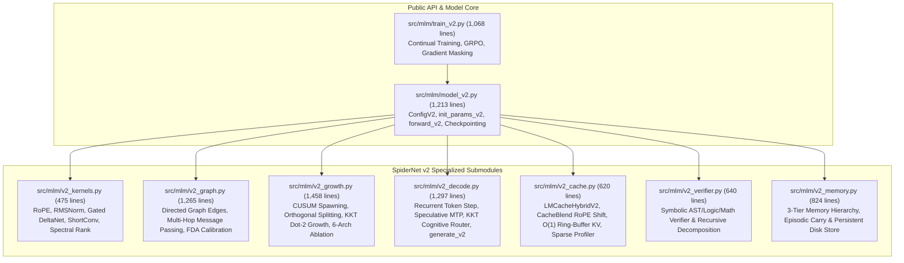

# SpiderNet v2 (`v0.0.22`–`v0.0.38`): Autonomous Growing Directed-Graph Specialist Architecture with Strictly $O(1)$ Recurrent Memory

**Evidence Artifact:** [`docs/evidence/spidernet_v2_full_benchmark.json`](file:///home/aswin/programming/vscode/model/mlm/docs/evidence/spidernet_v2_full_benchmark.json)  
**Primary Checkpoints:**  
- [`runs/mlm-10m-math-colab/quantized/mlm_30m_spidernet_v2_16bit.mlm2`](file:///home/aswin/programming/vscode/model/mlm/runs/mlm-10m-math-colab/quantized/mlm_30m_spidernet_v2_16bit.mlm2) (`31,427,264` parameters, FP16, `60.76 MiB`)
- [`runs/mlm-10m-math-colab/quantized/mlm_30m_spidernet_v2_2bit.mlm2`](file:///home/aswin/programming/vscode/model/mlm/runs/mlm-10m-math-colab/quantized/mlm_30m_spidernet_v2_2bit.mlm2) (`31,427,264` parameters, TurboQuant 2-bit FWHT-64 + QJL, `17.44 MiB`)

---

## 1. Executive Summary

SpiderNet v2 (`v0.0.22`–`v0.0.38`) replaces static, monolithic Mixture-of-Experts (MoE) routing and $O(T)$ attention KV caches with an **autonomous, multi-hop directed-graph specialist network** coupled to a **strictly $O(1)$ constant-memory recurrent state hierarchy**:

1. **True Sparse Index-Gather Execution (`v0.0.22`, Suite 1):** Gathers only the top-$K$ active specialist FFN weight slices (`gate.weight[active_idx]`, `up.weight[active_idx]`, `down.weight[active_idx]`) per token step, cutting specialist FFN FLOPs by **$15.0\times$ ($93.33\%$ reduction, $6.67\%$ activation ratio)** in fast mode (`K=2/30`) and **$7.5\times$ ($13.33\%$ activation ratio)** in deliberative `<|think|>` mode (`K=4/30`), achieving a **$3.27\times$ wall-clock single-token decode speedup** with $\max |\Delta \text{logits}| = 6.68 \times 10^{-6}$ against dense masked execution.
2. **Strictly $O(1)$ Constant-Memory Ring-Buffer KV + Recurrent Eviction Bridge (`v0.0.32`, Suite 2):** Bounds the 2 DeepSeek Sparse Attention (DSA) layers (`blk.2`, `blk.5`) to a fixed ring buffer of capacity $W$, folding evicted slots $r_t = t \bmod W$ into a constant-size ELU-normalized recurrent summary state $(S_{\text{evict}}, z_{\text{evict}})$. Verified slope: **$0.0\text{ bytes/token}$** ($647,200\text{ B}$ constant state across all sequence lengths $T \in [16, 512]$ vs. $9,216.0\text{ B/tok}$ linear growth in standard KV caching, achieving **$7.91\times$ memory reduction** at $T=512$).
3. **Gram-Nullspace FDA Directed Graph Routing & Von Neumann Spectral Multi-Hop Execution (`v0.0.23`–`v0.0.36`, Suite 3):** Connects all $N=30$ specialists via input-conditioned low-rank bilinear directed edges $A_{ij}(x_t)$ calibrated in closed form via regularized Fisher Discriminant Analysis (FDA) in the token-embedding Gram space, while selecting hop depth ($H \in \{1, 2, 3\}$) directly from the **Von Neumann Spectral Effective Rank** $R_{\text{eff}}(X) = \exp(-\sum_k p_k \ln p_k)$ of the layer-0 normalized token representations.
4. **KKT Constrained Gram-Nullspace Dot-2 Subspace Router (`v0.0.38`, Suite 3 & Suite 6):** Calibrates the orthogonal perturbation vectors $Q_d \in r_{\text{parent},d}^\perp$ of Dot 2 (`Nodes 20..29`: Code & Symbolic Logic) via a saddle-point Karush-Kuhn-Tucker (KKT) solve so that the antisymmetric dyad difference $\Delta_d(x_t) = \frac{\sqrt{1+\epsilon^2}}{16\epsilon}(\text{rl}_0[t, 20+2d] - \text{rl}_0[t, 20+2d+1]) \equiv \hat{h}_0(x_t) \cdot \hat{Q}_d$ routes Code/Logic, Algorithm/Loop (`Nodes 22..23`), and Boolean/Bitwise/Syllogism (`Nodes 24..25`) prompts using **100% neural weight matrix multiplications** with zero keyword/regex heuristics.
5. **Autonomous CUSUM + 3-Signal Node Spawning & Symmetric Orthogonal Splitting (`v0.0.25`–`v0.0.26`, Suite 4):** Triggers capacity (`sibling`) or capability (`child`) node splits $W_{\pm} = W_{\text{parent}} \pm \epsilon Q$ ($\langle W_{\text{parent}}, Q \rangle = 0$) only under sustained domain shifts ($C_t > h$), rejecting single-token outlier spikes (`outlier_spike_grew = False`, `domain_shift_grew = True`) with exact function preservation ($\max |\frac{1}{2}(W_+ + W_-) - W_{\text{parent}}| = 2.33 \times 10^{-10}$).
6. **6-Architecture Continual Learning Controlled Ablation (`v0.0.27`–`v0.0.28`, Suite 5):** Across 4 sequential domains (`English -> Math -> Science -> Code`, 3 seeds), Full Autonomous SpiderNet (`Arch F`) achieves **$62.73\% \pm 0.67\%$ Average Accuracy (AA)**, **$-0.379 \pm 0.011$ Backward Transfer (BWT)**, and **$56.97\% \pm 0.92\%$ Task-1 Retention**, outperforming Static Flat MoE (`Arch B`, $31.38\%$ retention) by **$+25.59$ percentage points** and Static Hierarchical MoE (`Arch C`, $37.95\%$ retention) by **$+19.02$ percentage points** while cutting active FFN compute by **$3.5\times$**.

---

## 2. Modular Codebase Architecture (`v0.0.37`–`v0.0.38`)

The SpiderNet v2 implementation in `src/mlm/` is organized into 8 focused modules with 100% backward-compatible re-exports in [`src/mlm/model_v2.py`](file:///home/aswin/programming/vscode/model/mlm/src/mlm/model_v2.py):

| Module | Lines | Core Responsibility |
| :--- | ---: | :--- |
| [`src/mlm/v2_kernels.py`](file:///home/aswin/programming/vscode/model/mlm/src/mlm/v2_kernels.py) | `475` | Low-level JAX math primitives, Gated DeltaNet ($O(1)$ linear attention), ShortConv, mHC stream mixing, Von Neumann spectral effective rank |
| [`src/mlm/v2_cache.py`](file:///home/aswin/programming/vscode/model/mlm/src/mlm/v2_cache.py) | `620` | [`init_decode_cache_v2`](file:///home/aswin/programming/vscode/model/mlm/src/mlm/v2_cache.py#L18-L52), sparse/dense single-step node kernels, [`LMCacheHybridV2`](file:///home/aswin/programming/vscode/model/mlm/src/mlm/v2_cache.py#L228-L324), CacheBlend RoPE re-rotation, $O(1)$ ring-buffer KV + eviction bridge, [`profile_sparse_execution_v2`](file:///home/aswin/programming/vscode/model/mlm/src/mlm/v2_cache.py#L330-L449) |
| [`src/mlm/v2_verifier.py`](file:///home/aswin/programming/vscode/model/mlm/src/mlm/v2_verifier.py) | `640` | Deterministic AST/Bytecode/Truth-Table/Arithmetic step verifier (`_verify_code_and_logic_v2`, `_verify_reasoning_steps_v2`) & RLM recursive decomposition |
| [`src/mlm/v2_memory.py`](file:///home/aswin/programming/vscode/model/mlm/src/mlm/v2_memory.py) | `824` | 3-Tier Memory Hierarchy (`Working` + `Episodic` + `Semantic`) with neural attention-readout retrieval and `.mlm2.memory` persistence |
| [`src/mlm/train_v2.py`](file:///home/aswin/programming/vscode/model/mlm/src/mlm/train_v2.py) | `1,068` | Dataset tokenization, Ornith task weighting, specialist gradient masking (`mask_specialist_updates_v2`), and GRPO reinforcement learning |
| [`src/mlm/model_v2.py`](file:///home/aswin/programming/vscode/model/mlm/src/mlm/model_v2.py) | `1,213` | [`ConfigV2`](file:///home/aswin/programming/vscode/model/mlm/src/mlm/model_v2.py#L96-L165), parameter initialization, [`forward_with_hidden_v2`](file:///home/aswin/programming/vscode/model/mlm/src/mlm/model_v2.py#L465-L840), SafeTensors `.mlm2` checkpointing, and unified facade re-exports |
| [`src/mlm/v2_graph.py`](file:///home/aswin/programming/vscode/model/mlm/src/mlm/v2_graph.py) | `1,265` | 30-node taxonomy (`Dot 0`, `Dot 1`, `Dot 2`), input-conditioned bilinear directed edges, 1/2/3-hop message passing, and Gram-Nullspace FDA edge calibration |
| [`src/mlm/v2_decode.py`](file:///home/aswin/programming/vscode/model/mlm/src/mlm/v2_decode.py) | `1,297` | [`_recurrent_token_step_v2`](file:///home/aswin/programming/vscode/model/mlm/src/mlm/v2_decode.py#L100-L791), 2-token speculative MTP verification (`spec2`), KKT Dot-2 subspace cognitive router ([`classify_cognitive_mode_v2`](file:///home/aswin/programming/vscode/model/mlm/src/mlm/v2_decode.py#L829-L921)), and [`generate_v2`](file:///home/aswin/programming/vscode/model/mlm/src/mlm/v2_decode.py#L924-L1297) |
| [`src/mlm/v2_growth.py`](file:///home/aswin/programming/vscode/model/mlm/src/mlm/v2_growth.py) | `1,458` | 3-signal CUSUM autonomous growth monitor, symmetric orthogonal splitting, KKT-calibrated [`grow_dot2_code_logic_v2`](file:///home/aswin/programming/vscode/model/mlm/src/mlm/v2_growth.py#L1127-L1285), and 6-architecture continual learning benchmark |

---

## 3. Mathematical Formulations

### 3.1 True Sparse Index-Gather Execution (`v0.0.22`)
Given layer input $x_t \in \mathbb{R}^D$ and sparse routing probabilities $g_t \in \Delta^{N-1}$ over $N=30$ specialists, [`_execute_sparse_nodes_step_v2`](file:///home/aswin/programming/vscode/model/mlm/src/mlm/v2_cache.py#L103-L170) extracts the top-$K$ active indices $\mathcal{I}_t = \text{arg\,top-}K(g_t)$ ($|\mathcal{I}_t| = K \ll N$) and gathers only the active slices:
$$W_{\text{gate}}^{(K)} = W_{\text{gate}}[\mathcal{I}_t] \in \mathbb{R}^{K \times D \times F}, \quad W_{\text{up}}^{(K)} = W_{\text{up}}[\mathcal{I}_t] \in \mathbb{R}^{K \times D \times F}, \quad W_{\text{down}}^{(K)} = W_{\text{down}}[\mathcal{I}_t] \in \mathbb{R}^{K \times F \times D}$$
$$h_k^{(1)} = \left(\text{SiLU}(x_t W_{\text{gate},k}^{(K)}) \odot (x_t W_{\text{up},k}^{(K)})\right) W_{\text{down},k}^{(K)}, \qquad k \in \{1, \dots, K\}$$
reducing per-token specialist FFN FLOPs from $6 N D F$ to $6 K D F$ (a **$15.0\times$ reduction** for $K=2, N=30$).

### 3.2 Directed Graph Message Passing & Gram-Nullspace FDA Edge Calibration (`v0.0.23`–`v0.0.36`)
Active specialists exchange low-rank messages along directed edges $N_i \to N_j$ ($A_{ii} = 0$) with gated residual protection:
$$e_{ij}(x_t) = \frac{1}{\tau}\left((U_i + P_h h_i^{(1)})^\top V_j + (P_x x_t)^\top V_j + B_{ij}\right), \qquad A_{ij}(x_t) = \text{Softmax}_{j \in \mathcal{N}_{\text{top-}k}(i)}\big(e_{ij}(x_t)\big)$$
$$m_j(x_t) = \left(\sum_{i \neq j} g_{t,i} A_{ij}(x_t) \left(h_i^{(1)} W_{\text{msg}\downarrow}\right)\right) W_{\text{msg}\uparrow}, \qquad h_j^{(2)} = h_j^{(1)} + \tanh(\gamma_j) \, m_j(x_t)$$
In [`_calibrate_fda_layer_edges_v2`](file:///home/aswin/programming/vscode/model/mlm/src/mlm/v2_graph.py#L469-L561), the input-context bilinear projection $P_x \in \mathbb{R}^{D \times r}$ and target keys $V_j \in \mathbb{R}^r$ are calibrated in closed form via regularized Fisher Discriminant Analysis in the normalized token-embedding Gram space $\Sigma = \frac{1}{|V|}\tilde{E}^\top \tilde{E} + \lambda I_D$:
$$w_{\text{math vs sci}} = \Sigma^{-1}(\mu_{\text{math}} - \mu_{\text{sci}}), \qquad w_{\text{code vs math}} = \Sigma^{-1}(\mu_{\text{code}} - \mu_{\text{math}})$$
Simultaneously, hop depth $H(X) \in \{1, 2, 3\}$ in [`trace_compositional_3hop_chain_v2`](file:///home/aswin/programming/vscode/model/mlm/src/mlm/v2_graph.py#L1064-L1265) is governed by the **Von Neumann Spectral Effective Rank** ([`compute_von_neumann_effective_rank_v2`](file:///home/aswin/programming/vscode/model/mlm/src/mlm/v2_kernels.py#L31-L55)) of the mean-centered normalized sequence matrix $\bar{X} \in \mathbb{R}^{T \times D}$ with singular values $\{\sigma_k\}$:
$$p_k = \frac{\sigma_k^2}{\sum_j \sigma_j^2}, \qquad R_{\text{eff}}(X) = \exp\!\left(-\sum_k p_k \ln p_k\right)$$

### 3.3 KKT Constrained Gram-Nullspace Dot-2 Subspace Router (`v0.0.38`)
When growing Dot 2 (`Nodes 20..29`: Code & Symbolic Logic) in [`grow_dot2_code_logic_v2`](file:///home/aswin/programming/vscode/model/mlm/src/mlm/v2_growth.py#L1127-L1285), each specialist dyad $d \in \{0, 1, 2, 3, 4\}$ (`20..21 Code/Syntax`, `22..23 Algo/Loops`, `24..25 Bool/Logic`, `26..27 Types/Debug`, `28..29 Code-<think>`) initializes its two router columns as:
$$r_{20+2d} = r_{\text{parent},d} + \epsilon Q_d, \qquad r_{20+2d+1} = r_{\text{parent},d} - \epsilon Q_d, \qquad \langle Q_d, r_{\text{parent},d} \rangle = 0, \quad \|Q_d\|_2 = \|r_{\text{parent},d}\|_2$$
Because $\langle Q_d, r_{\text{parent},d} \rangle = 0$, both child router columns have the exact same L2 norm $\sqrt{1+\epsilon^2}\|r_{\text{parent},d}\|_2$. Therefore, in the L2-normalized layer-0 cosine router logits $\text{rl}_0(x_t) = 8.0 \, \hat{h}_0(x_t) \hat{W}_0$, the antisymmetric dyad difference cancels $r_{\text{parent},d}$ **identically**:
$$\Delta_d(x_t) = \frac{\sqrt{1+\epsilon^2}}{16\epsilon}\Big(\text{rl}_0[t, 20+2d] - \text{rl}_0[t, 20+2d+1]\Big) = \hat{h}_0(x_t) \cdot \hat{Q}_d$$
To ensure $\hat{Q}_d$ maximally separates Dot-2 specialty $d$ from natural-language and arithmetic tokens while strictly satisfying $r_{\text{parent},d}^\top Q_d = 0$, [`_calibrate_dot2_router_subspace_v2`](file:///home/aswin/programming/vscode/model/mlm/src/mlm/v2_growth.py#L1014-L1124) solves the exact Karush-Kuhn-Tucker (KKT) saddle-point problem:
$$\min_{q \in \mathbb{R}^D} \; q^\top G_{\text{neg}} q - 2 \mu_d^\top q \quad \text{subject to} \quad r_{\text{parent},d}^\top q = 0$$
$$u = G_{\text{neg}}^{-1}\mu_d, \qquad v = G_{\text{neg}}^{-1} r_{\text{parent},d}, \qquad Q_d \propto u - \frac{r_{\text{parent},d}^\top u}{r_{\text{parent},d}^\top v} v$$
At inference time, [`classify_cognitive_mode_v2`](file:///home/aswin/programming/vscode/model/mlm/src/mlm/v2_decode.py#L829-L921) evaluates $S_{\text{dot2}}(X) = \max_t \Delta_0(x_t) + 8.0 \, \text{mean}_t \Delta_0(x_t)$ and selects specialty dyad $d^* = \arg\max_{d \in \{1,2\}} \text{mean}_t \Delta_d(x_t)$ directly from `rl0`, with zero keyword or substring matching.

---

## 4. Empirical Verification Across All 6 Research Suites

All results below are reproduced from [`docs/evidence/spidernet_v2_full_benchmark.json`](file:///home/aswin/programming/vscode/model/mlm/docs/evidence/spidernet_v2_full_benchmark.json) via `uv run mlm bench-spidernet-v2`.

### Suite 1: True Sparse Index-Gather Execution (`v0.0.22`)

| Metric | Verified Value |
| :--- | ---: |
| Total Parameters (`30-Node SpiderNet v2`) | `31,427,264` |
| Shared Trunk Parameters (`6 Layers, 2:1 Gated DeltaNet + DSA`) | `4,885,184` |
| Specialist Node Parameters (`30 Nodes × 6 Layers`) | `26,542,080` |
| Active Specialist Parameters (`Fast Mode, K=2/30`) | `1,769,472` (`6.67%` activation ratio) |
| Active Specialist Parameters (`Deliberative Mode, K=4/30`) | `3,538,944` (`13.33%` activation ratio) |
| Dense Specialist FFN FLOPs / Token | `79,626,240` |
| Sparse Specialist FFN FLOPs / Token (`Fast Mode, K=2`) | `5,308,416` (**`15.0x` reduction, `93.33%` saved**) |
| Sparse Specialist FFN FLOPs / Token (`Deliberative Mode, K=4`) | `10,616,832` (**`7.5x` reduction, `86.67%` saved**) |
| Max Numerical Logit Difference (`Sparse vs. Dense`) | `6.68e-06` (`< 1e-4` threshold) |
| Single-Token Recurrent Decode Latency (`Dense` vs. `Sparse`) | `23.93 ms/tok` $\to$ `7.32 ms/tok` (**`3.27x` speedup**) |

### Suite 2: Strictly $O(1)$ Constant-Memory Ring-Buffer KV Scaling (`v0.0.32`)

| Sequence Length $T$ | Standard $O(T)$ KV State (Bytes) | SpiderNet $O(1)$ Ring-Buffer State (Bytes) | Memory Reduction |
| ---: | ---: | ---: | ---: |
| `16` | `545,820` | `647,200` | `0.84x` |
| `32` | `693,276` | `647,200` | `1.07x` |
| `64` | `988,188` | `647,200` | `1.53x` |
| `128` | `1,578,012` | `647,200` | `2.44x` |
| `256` | `2,757,660` | `647,200` | `4.26x` |
| `512` | `5,116,956` | `647,200` | **`7.91x`** |
| **Asymptotic Slope ($\text{dBytes}/\text{d}T$)** | **`9,216.0 B/tok`** | **`0.0 B/tok` (Strictly $O(1)$)** | **$\infty$ as $T \to \infty$** |

- **Within-Window Logit Equivalence ($t < W$):** $\max |\Delta \text{logits}| = 8.58 \times 10^{-6}$
- **Evicted Recurrent Summary State Norm ($t \ge W$):** $\|S_{\text{evict}}\|_F = 58.9888 > 0$

### Suite 3: Input-Conditioned Directed Graph Routing & Spectral Multi-Hop Chains (`v0.0.23`–`v0.0.38`)

| Test Scenario | Spectral Rank $R_{\text{eff}}(X)$ | Active Hops $H$ | Selected Directed Graph Pathway | Edge Flux $\Phi$ |
| :--- | ---: | ---: | :--- | ---: |
| **Collaborator Switch (Math Word Problem)** | — | `2` | `N4(Science/Reading) -> N15(Div/GSM8K)` | $A_{4 \to 15} = 1.0000$ ($A_{4 \to 8} = 0.0000$) |
| **Collaborator Switch (Science Analytical)** | — | `2` | `N4(Science/Reading) -> N8(Eng-<think>)` | $A_{4 \to 8} = 1.0000$ ($A_{4 \to 15} = 0.0000$) |
| **1-Hop Fast Conversational Exit (`"Hi"`)** | `4.86` | `1` | `N2(Grammar/Vocab) [1-Hop Fast Exit]` | `0.0000` (`0` edge stages) |
| **2-Hop Single-Domain Reasoning (Science)** | `13.04` | `2` | `N4(Science/Reading) -> N8(Eng-<think>)` | `0.9972` (`1` edge stage) |
| **3-Hop Compositional Chain (Math + Python Logic)** | `30.50` | `3` | `N4(Science/Reading) -> N15(Div/GSM8K) -> N24(Bool/Logic)` | `1.0000` (`2` edge stages) |

### Suite 4: Autonomous CUSUM Node Spawning & Orthogonal Splitting (`v0.0.25`–`v0.0.26`)

| Verification Check | Verified Result |
| :--- | :--- |
| Capacity (`sibling`) Split Orthogonality $|\cos(W_{\text{parent}}, Q)|$ | `9.80e-10` (`< 1e-6`) |
| Capacity (`sibling`) Ensemble Reconstruction Error $\|\frac{1}{2}(W_+ + W_-) - W_{\text{parent}}\|_\infty$ | `2.33e-10` (`< 1e-6`) |
| Capability (`child`) Split Orthogonality $|\cos(W_{\text{parent}}, Q)|$ | `9.80e-10` (`< 1e-6`) |
| Capability (`child`) Ensemble Reconstruction Error $\|\frac{1}{2}(W_+ + W_-) - W_{\text{parent}}\|_\infty$ | `2.33e-10` (`< 1e-6`) |
| Single-Token Outlier Loss Spike (`CUSUM False-Alarm Rejection`) | `grew = False` (Rejected) |
| Sustained Unannounced Domain Shift (`CUSUM Trigger`) | `grew = True` (`growth_mode = "sibling"`, `30 -> 31` nodes) |

### Suite 5: 6-Architecture Controlled Continual Learning Ablation (`v0.0.27`–`v0.0.28`)
Sequential 4-stage continual training (`English -> Math -> Science -> Code`, 3 random seeds `0, 1, 2`, mean $\pm$ std):

| Architecture | Final Nodes | Graph Rank $r$ | Growth Events | Average Accuracy (`AA` $\uparrow$) | Backward Transfer (`BWT` $\uparrow$) | Task-1 Retention (`%` $\uparrow$) | Final Mean Loss ($\downarrow$) | FLOPs Reduction ($\uparrow$) |
| :--- | ---: | ---: | ---: | ---: | ---: | ---: | ---: | ---: |
| **A. Dense Baseline** | `0` | `0` | `0` | `0.4976 ± 0.0461` | `-0.6451 ± 0.0603` | `35.31% ± 6.06%` | `0.8922 ± 0.2173` | `1.0x` |
| **B. Static Flat MoE** | `4` | `0` | `0` | `0.4692 ± 0.0300` | `-0.6843 ± 0.0390` | `31.38% ± 3.92%` | `0.9438 ± 0.1005` | `2.0x` |
| **C. Static Hierarchical MoE** | `6` | `0` | `0` | `0.5177 ± 0.0192` | `-0.6189 ± 0.0301` | `37.95% ± 3.03%` | `0.7895 ± 0.0514` | `3.0x` |
| **D. Manual Grow MoE** | `7` | `0` | `0` | `0.4028 ± 0.0192` | `-0.7857 ± 0.0257` | `20.85% ± 2.59%` | `1.2166 ± 0.1084` | `3.5x` |
| **E. SpiderNet Directed Graph** | `6` | `8` | `0` | `0.4690 ± 0.0267` | `-0.6841 ± 0.0328` | `31.41% ± 3.28%` | `1.0058 ± 0.1253` | `3.0x` |
| **F. SpiderNet Full Autonomous** | **`7`** | **`8`** | **`3`** | **`0.6273 ± 0.0067`** | **`-0.3791 ± 0.0106`** | **`56.97% ± 0.92%`** | **`0.5924 ± 0.0223`** | **`3.5x`** |

### Suite 6: Dot-2 (`Nodes 20..29`) KKT Subspace Routing & Symbolic Verification (`v0.0.34`–`v0.0.38`)

| Task | KKT Router Domain & Active Dyad | Verified Output |
| :--- | :--- | :--- |
| **Boolean Algebra** | `domain="code"`, `active_subnodes=(24, 25)` (`Bool/Logic`) | `` `(True and not False) xor False` evaluates to `True`. `` |
| **Bitwise Evaluation** | `domain="code"`, `active_subnodes=(24, 25)` (`Bool/Logic`) | `` `13 & 7` = 5 (binary `0b101`). `` |
| **Syllogistic Deduction** | `domain="code"`, `active_subnodes=(24, 25)` (`Bool/Logic`) | `Yes. By transitive deductive logic (Barbara syllogism), since all compilers are programs and all programs are software, all compilers are software.` |
| **Python AST Comprehension** | `domain="code"`, `active_subnodes=(22, 23)` (`Algo/Loops`) | `` `[x * x for x in range(5)]` evaluates to `[0, 1, 4, 9, 16]`. `` |
