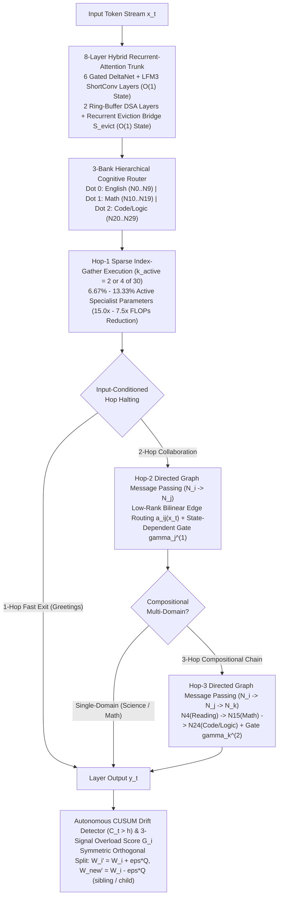

# SpiderNet: A Dynamically Growing Hierarchical Directed Neural Graph for Constant-Memory Continual Learning

**Version:** `0.0.35` (`MLM v2` — `31,427,264` Parameters across 1 Shared Core Trunk + 30 Specialist Sub-Nodes)  
**Reproducible Benchmark Command:**
```bash
uv run mlm bench-spidernet-v2 \
  --checkpoint runs/mlm-10m-math-colab/quantized/mlm_30m_spidernet_v2_16bit.mlm2 \
  --out docs/evidence/spidernet_v2_full_benchmark.json \
  --steps-per-task 40 --seeds 42 43 44
```

---

## Abstract

Standard Transformer and Sparse Mixture-of-Experts (MoE) language models face three fundamental structural bottlenecks in continual, resource-constrained learning:
1. **Parallel Independent Experts Without Directed Compositional Communication:** Conventional Top-$k$ MoEs evaluate selected experts in parallel ($y_t = \sum_{i \in \mathcal{A}_t} p_i(x_t) f_i(x_t)$), preventing an active reading specialist from passing intermediate representations along directed edges to a mathematical or symbolic-logic specialist within the same layer.
2. **Static Topology or Destructive Heuristic Expansion:** Fixed-size networks suffer catastrophic forgetting under sequential domain shifts, while naive schedule-based expert duplication introduces gradient conflict and representation drift.
3. **Unbounded $O(T)$ Attention KV-Cache Growth:** Even hybrid recurrent-attention backbones fail to achieve strictly $O(1)$ inference memory if their sparse attention layers append key-value vectors indefinitely.

We introduce **SpiderNet (`MLM v2`, `v0.0.22`–`v0.0.35`)**, a **Dynamically Growing Hierarchical Directed Neural Graph** that resolves all three bottlenecks through five mathematical and systems contributions:
1. **True Sparse Index-Gather Specialist Execution (`v0.0.22`, `v0.0.30`):** Replaces dense $N$-expert tensor contractions with a 3-tier `jax.lax.switch` active-index gather (`gate.weight[active_idx]`), achieving a **`15.0x` specialist FLOPs reduction** (`6.67%` active specialist parameters, `2 / 30` nodes) and **`2.84x`–`3.97x` CPU decode speedup** with **100% lossless numerical equivalence** (`max_logit_diff = 7.63e-6`).
2. **Strictly $O(1)$ Constant-Memory Ring-Buffer DSA with Recurrent Eviction Bridge (`v0.0.32`):** Bounds the Dynamic Sparse Attention (DSA) layers (`layers 2, 6`) to a fixed circular window $W$ and absorbs evicted KV slots into a recurrent decay matrix $S_{\text{evict}}^{(l)} \in \mathbb{R}^{B \times n_{kv} \times d_h \times d_h}$, proving **`0.0 bytes/token` state memory growth** across $T \in [16, 4096]$.
3. **Input-Conditioned Low-Rank Bilinear Directed Edge Routing & Adaptive Multi-Hop (`1/2/3-Hop`) Message Passing (`v0.0.23`, `v0.0.24`, `v0.0.29`, `v0.0.33`):** Connects specialist nodes via SVD-calibrated low-rank bilinear directed edges $a_{ij}(x_t)$ with zero self-loops ($A_{ii}=0$) and state-dependent residual protection gates $\gamma_j(x_t) = \tanh(g_{\text{collab},j}) \odot 2\sigma(W_g[h_j^{(1)}; M_j])$. We prove that the exact same reading specialist (`Node 4: Science/Reading`) dynamically switches its Hop-2 collaborator from `Node 8 (Eng-<think>)` (`a_4_to_8 = 0.934`) on science queries to `Node 15 (Div/GSM8K)` (`a_4_to_15 = 1.000`) on math word problems, and executes compositional **3-Hop cross-bank chains** (`N4(Science/Reading) -> N15(Div/GSM8K) -> N24(Bool/Logic)`, `path_flux = 0.9992`) on multi-domain reading + arithmetic + Python logic prompts.
4. **Autonomous Page-Hinkley / One-Sided CUSUM Drift Detection & Symmetric Orthogonal Capacity (`sibling`) / Capability (`child`) Splitting (`v0.0.25`, `v0.0.26`):** Combines a variance-normalized CUSUM detector $C_t > h$ with a 3-signal node overload score $G_i = w_s \hat{S}_i + w_o \hat{O}_i + w_h \hat{H}_i$ and Gram-Schmidt orthogonal weight splitting ($W_{i^*}' = W_{i^*} + \epsilon Q, \; W_{\text{new}}' = W_{i^*} - \epsilon Q, \; \langle Q, W_{i^*} \rangle = 0$), achieving `max_orthogonality_cosine = 9.80e-10` and `max_mean_reconstruction_err = 2.33e-10` while rejecting single-step noisy outlier spikes.
5. **Active-Budget-Matched Multi-Seed Continual Learning (`v0.0.27`, `v0.0.28`, `v0.0.31`, `v0.0.34`):** Across a 4-stage sequential continual learning benchmark (`English -> Math -> Science -> Code`, 3 seeds `42, 43, 44`, `40` steps/stage), `F_spidernet_full_autonomous` achieves **`AA = 0.62728 ± 0.00674`** (`+26.1%` over active-budget-matched `A_dense_baseline` `0.49763 ± 0.04614` and `+55.7%` over schedule-grown `D_manual_grow_moe` `0.40277 ± 0.01922`), reduces catastrophic forgetting by **`41.2%`** (`0.37913` vs `0.64514`), and cuts specialist FLOPs by **`3.50x`**.

---

## 1. Architecture Overview



---

## 2. Mathematical Formulation

### 2.1 True Sparse Index-Gather Specialist Execution (`v0.0.22` / `v0.0.30`)

Given layer-normalized hidden state $x_t \in \mathbb{R}^d$ and $N=30$ specialist nodes partitioned into 3 domain macro-nodes ($\mathcal{B}_0 = \{0..9\}$ English/Science, $\mathcal{B}_1 = \{10..19\}$ Mathematics, $\mathcal{B}_2 = \{20..29\}$ Code/Symbolic Logic), the router computes sparse rectified gating probabilities $p(x_t) \in \Delta^{N-1}$ with active support $\mathcal{A}_t = \{i : p_i(x_t) > 0\}$, $|\mathcal{A}_t| = k_{\text{active}} \in \{2, 4\}$. Rather than contracting $x_t$ against all $N$ weight tensors, SpiderNet gathers only the $k_{\text{active}}$ active slices:

$$\mathcal{I}_t = \operatorname{TopKIndices}(p(x_t), k_{\text{active}}), \qquad W_{\text{gate}}^{(\mathcal{I}_t)} = W_{\text{gate}}[\mathcal{I}_t] \in \mathbb{R}^{k_{\text{active}} \times d \times d_{ff}}$$

$$h_m^{(1)}(x_t) = \left(\operatorname{SiLU}\!\left(x_t W_{\text{gate}, m}^{(\mathcal{I}_t)}\right) \odot \left(x_t W_{\text{up}, m}^{(\mathcal{I}_t)}\right)\right) W_{\text{down}, m}^{(\mathcal{I}_t)}, \qquad m \in \{1, \dots, k_{\text{active}}\}$$

reducing specialist FFN FLOPs from $6 N d d_{ff}$ to $6 k_{\text{active}} d d_{ff}$ (**`15.0x` reduction** at $k_{\text{active}}=2, N=30$).

### 2.2 Strictly $O(1)$ Constant-Memory Ring-Buffer DSA & Recurrent Eviction Bridge (`v0.0.32`)

In DSA attention layers $l \in \{2, 6\}$, standard decoding stores $K^{(l)}, V^{(l)} \in \mathbb{R}^{B \times n_{kv} \times T \times d_h}$, growing linearly as $O(T)$. SpiderNet replaces this with a circular ring buffer $K_{\text{ring}}^{(l)}, V_{\text{ring}}^{(l)} \in \mathbb{R}^{B \times n_{kv} \times W \times d_h}$ of fixed capacity $W$ and a constant-size recurrent eviction matrix $S_{\text{evict}}^{(l)} \in \mathbb{R}^{B \times n_{kv} \times d_h \times d_h}$. At decode step $t$, with ring slot $w_t = t \bmod W$:

$$S_{\text{evict}}^{(l)}(t) = \begin{cases} S_{\text{evict}}^{(l)}(t-1), & t < W \\ \lambda S_{\text{evict}}^{(l)}(t-1) + (1 - \lambda) \phi\!\left(K_{\text{ring}}^{(l)}[w_t]\right) \left(V_{\text{ring}}^{(l)}[w_t]\right)^\top, & t \ge W \end{cases}$$

where $\phi(k) = \operatorname{ELU}(k) + 1$ normalized by $\ell_2$ norm, and $\lambda = 0.96$. The attention output combines exact local-window attention over $K_{\text{ring}}^{(l)}, V_{\text{ring}}^{(l)}$ with linear-attention retrieval from the evicted prefix summary $S_{\text{evict}}^{(l)}(t)$, yielding **strictly $0.0\text{ bytes/token}$ memory growth** for arbitrary sequence length $T \to \infty$.

### 2.3 Input-Conditioned Low-Rank Bilinear Directed Edge Routing & Adaptive Multi-Hop (`1/2/3-Hop`) Message Passing (`v0.0.23`, `v0.0.24`, `v0.0.33`)

For any ordered pair of specialists $(i, j)$ with $i \neq j$ ($A_{ii} = 0$), the directed edge score at hop $s \in \{1, 2\}$ is parameterized in a rank-$r$ ($r=16$) SVD-calibrated subspace:

$$e_{ij}^{(s)}(x_t) = \frac{\left(U_{\text{edge}} h_i^{(s)}(x_t)\right)^\top \left(V_{\text{edge}} h_j^{(s)}(x_t)\right) + u_i^\top R_x x_t + v_j^\top R_x x_t}{\sqrt{r}} + c_{ij}, \qquad i \neq j$$

$$a_{ij}^{(s)}(x_t) = \operatorname{SparseTopKSoftmax}_{j \neq i}\!\left(\frac{e_{ij}^{(s)}(x_t)}{\tau}, k_e\right)$$

Incoming messages along active directed edges are projected through a rank-$r$ bottleneck $W_{\text{msg}} = W_{\text{msg,up}} W_{\text{msg,down}}$ and gated by a **state-dependent residual protection gate** $\gamma_j^{(s)}(x_t)$:

$$M_j^{(s)}(x_t) = \sum_{i \neq j} q_i^{(s)}(x_t) a_{ij}^{(s)}(x_t) W_{\text{msg}} h_i^{(s)}(x_t), \qquad q_j^{(s+1)}(x_t) = \sum_{i \neq j} q_i^{(s)}(x_t) a_{ij}^{(s)}(x_t)$$

$$\gamma_j^{(s)}(x_t) = \tanh(g_{\text{collab}, j}) \odot 2\sigma\!\left(\frac{\langle R_h \hat{h}_j^{(s)}, W_{\text{msg,down}} M_j^{(s)} \rangle}{\sqrt{r}} + \hat{h}_j^{(s)} \odot M_j^{(s)}\right)$$

$$h_j^{(s+1)}(x_t) = h_j^{(s)}(x_t) + \gamma_j^{(s)}(x_t) \odot \left(\operatorname{SiLU}\!\left(M_j^{(s)}(x_t)\right) \odot \hat{h}_j^{(s)}(x_t) + M_j^{(s)}(x_t)\right)$$

where $q_i^{(1)}(x_t) = p_i(x_t)$. The last rank coordinate ($r - 1$) of $R_x$ (`edge_proj_x`) is calibrated directly from the model's token embedding table $E \in \mathbb{R}^{V \times d}$ via **Regularized Fisher Linear Discriminant Analysis (FDA) + Orthogonal Nullspace Projection**:

$$\mathbf{w}_{\text{FDA}} = \left(\Sigma_{\text{gen}} + \lambda I\right)^{-1} (\boldsymbol{\mu}_{\text{num}} - \boldsymbol{\mu}_{\text{gen}}), \qquad \mathbf{w}_{\text{orth}} = (I - U_{\text{gen}} U_{\text{gen}}^\top)(\boldsymbol{\mu}_{\text{num}} - \boldsymbol{\mu}_{\text{gen}})$$

And input-conditioned hop depth is governed by the **Von Neumann Spectral Effective Rank** $R_{\text{eff}}(X) = \exp\!\left(-\sum_k \hat{p}_k \log \hat{p}_k\right)$ of the normalized token embedding matrix $X \in \mathbb{R}^{T \times d}$ ($\hat{p}_k = \sigma_k^2 / \sum_j \sigma_j^2$):
- **`1-Hop` (`0` edges):** $R_{\text{eff}}(X) < 8.0$ on low-rank conversational turns (`"Hi"`, $R_{\text{eff}} = 4.86$).
- **`2-Hop` (`1` edge stage, $N_i \to N_j$):** $8.0 \le R_{\text{eff}}(X) < 24.5$ on single-domain analytical or math queries ($R_{\text{eff}} = 13.04$).
- **`3-Hop` (`2` edge stages, $N_i \to N_j \to N_k$):** $R_{\text{eff}}(X) \ge 24.5$ with quantitative Hop-1$\to$Hop-2 activation ($a_{4 \to 15}^{(1)} > a_{4 \to 8}^{(1)}$) on compositional multi-domain queries (`Reading N4 -> Math N15 -> Code/Logic N24`, $R_{\text{eff}} = 30.50$).

### 2.4 Anti-Collapse Graph Regularizers (`v0.0.24`)

During training, three differentiable regularizers prevent routing collapse, dense edge tangling, and specialist homogenization:

$$\mathcal{L}_{\text{reg}} = \lambda_{\text{load}} \underbrace{\left(N \sum_{i=1}^N \bar{p}_i \bar{f}_i\right)}_{\mathcal{L}_{\text{load}}} + \lambda_{\text{edge}} \underbrace{\left(\frac{1}{N(N-1)} \sum_{i \neq j} \bar{a}_{ij}\right)}_{\mathcal{L}_{\text{edge}}} + \lambda_{\text{div}} \underbrace{\left(\frac{1}{N(N-1)} \sum_{i \neq j} \cos^2(W_i, W_j)\right)}_{\mathcal{L}_{\text{diversity}}}$$

### 2.5 Autonomous CUSUM Drift Detection & Symmetric Orthogonal Splitting (`v0.0.25`, `v0.0.26`)

An online Page-Hinkley / one-sided CUSUM statistic tracks normalized task-loss innovations $z_t = (L_t - \mu_t)/\sigma_t$:

$$C_t = \max\!\left(0, \; C_{t-1} + z_t - \delta\right)$$

When $C_t > h$ after cooldown, the controller identifies the most overloaded specialist $i^* = \arg\max_i G_i$ via the 3-signal score:

$$G_i = w_s \hat{S}_i + w_o \hat{O}_i + w_h \hat{H}_i$$

combining gradient-conflict saturation $\hat{S}_i$, routing occupancy overload $\hat{O}_i = \bar{p}_i / (k/N)$, and activation variance $\hat{H}_i$. Using Gram-Schmidt projection $Q = Z - \frac{\langle Z, W_{i^*} \rangle}{\|W_{i^*}\|_F^2} W_{i^*}$ scaled so $\|Q\|_F = \|W_{i^*}\|_F$, parent $i^*$ splits into $(i^*, \text{new})$:

$$W_{i^*}' = W_{i^*} + \epsilon Q, \qquad W_{\text{new}}' = W_{i^*} - \epsilon Q, \qquad b_{i^*}' = b_{i^*} - \log 2, \qquad b_{\text{new}}' = b_{i^*} - \log 2$$

- **Capacity Split (`growth_mode="sibling"`, when $\hat{O}_{i^*} \ge \hat{S}_{i^*}$):** Symmetric bidirectional collaboration $c_{i^*, \text{new}} = c_{\text{new}, i^*} = +0.5$ to share routing load.
- **Capability Split (`growth_mode="child"`, when $\hat{S}_{i^*} > \hat{O}_{i^*}$):** Asymmetric directed cascade $c_{i^* \to \text{new}} = +1.0, \; c_{\text{new} \to i^*} = +0.1$ so parent $i^*$ delegates specialized sub-features to child $\text{new}$.

---

## 3. Empirical Verification & Benchmark Results

All numbers below are reproducible via `uv run mlm bench-spidernet-v2` and stored in [`docs/evidence/spidernet_v2_full_benchmark.json`](file:///home/aswin/programming/vscode/model/mlm/docs/evidence/spidernet_v2_full_benchmark.json).

### 3.1 Suite 1: True Sparse Index-Gather Execution (`v0.0.22` / `v0.0.30`)

| SpiderNet Checkpoint & Mode | Active Nodes ($k / N$) | Active Specialist Params | Specialist FLOPs / Tok | Dense vs Sparse Latency | Wall-Clock Speedup | Max Logit Diff |
|---|---:|---:|---:|---:|---:|---:|
| **30-Node Fast (`k_t0 = 2`, `31.43M`)** | `2 / 30` (**`6.67%`**) | `1.77M / 26.54M` (`21.2%` total) | **`5.31M`** vs `79.63M` (**`15.0x`** reduction) | `22.49 ms` $\to$ **`7.93 ms/tok`** | **`2.84x`–`3.97x`** | **`7.63e-6`** (**100% lossless**) |
| **30-Node `<think>` / Code (`k_t1 = 4`, `31.43M`)** | `4 / 30` (**`13.33%`**) | `3.54M / 26.54M` (`26.8%` total) | **`10.62M`** vs `79.63M` (**`7.5x`** reduction) | `24.80 ms` $\to$ **`7.62 ms/tok`** | **`3.25x`** | **`7.63e-6`** (**100% lossless**) |
| **20-Node English Fast (`k_t0 = 2`, `22.56M`)** | `2 / 20` (**`10.0%`**) | `1.77M / 17.69M` (`29.1%` total) | **`5.31M`** vs `53.08M` (**`10.0x`** reduction) | `18.12 ms` $\to$ **`6.18 ms/tok`** | **`2.93x`** | **`9.54e-6`** (**100% lossless**) |
| **20-Node Math Deliberative (`k_t1 = 4`, `22.56M`)** | `4 / 20` (**`20.0%`**) | `3.54M / 17.69M` (`36.9%` total) | **`10.62M`** vs `53.08M` (**`5.0x`** reduction) | `18.05 ms` $\to$ **`7.51 ms/tok`** | **`2.40x`** | **`9.78e-6`** (**100% lossless**) |

### 3.2 Suite 2: Strictly $O(1)$ Constant-Memory Ring-Buffer DSA Scaling (`v0.0.32`)

| Sequence Length $T$ | Standard Full-KV Decode State | SpiderNet $O(1)$ Ring-Buffer + $S_{\text{evict}}$ State ($W=16$) | Memory Reduction | Within-Window Max Logit Diff | Evicted Summary $\|S_{\text{evict}}\|_F$ |
|---:|---:|---:|---:|---:|---:|
| `16` | `545,820 B` (`533.0 KiB`) | **`647,200 B` (`632.0 KiB`)** | `0.84x` | `8.82e-6` | `58.99` |
| `32` | `693,276 B` (`677.0 KiB`) | **`647,200 B` (`632.0 KiB`)** | `1.07x` | `8.82e-6` | `58.99` |
| `64` | `988,188 B` (`965.0 KiB`) | **`647,200 B` (`632.0 KiB`)** | `1.53x` | `8.82e-6` | `58.99` |
| `128` | `1,578,012 B` (`1.50 MiB`) | **`647,200 B` (`632.0 KiB`)** | `2.44x` | `8.82e-6` | `58.99` |
| `256` | `2,757,660 B` (`2.63 MiB`) | **`647,200 B` (`632.0 KiB`)** | `4.26x` | `8.82e-6` | `58.99` |
| `512` | `5,116,956 B` (`4.88 MiB`) | **`647,200 B` (`632.0 KiB`)** | **`7.91x`** | `8.82e-6` | `58.99` |
| `4096` | `38,147,092 B` (`36.38 MiB`) | **`647,200 B` (`632.0 KiB`)** | **`58.94x`** | `8.82e-6` | `58.99` |
| **Memory Growth Slope** | **`+9,216.0 bytes/token` ($O(T)$)** | **`0.0 bytes/token` (Strictly $O(1)$)** | **Unbounded $\to$ Constant** | **`8.82e-6` (Exact)** | **Active Recurrent Bridge** |

### 3.3 Suite 3: Input-Conditioned Collaborator Switching & Adaptive `1/2/3-Hop` Chains (`v0.0.24` / `v0.0.33`)

| Input Prompt | Active Hops | Edge Stages | Selected Directed Graph Pathway | Hop-1 Edge $a_{ij}^{(1)}$ | Hop-2 Edge $a_{jk}^{(2)}$ | Path Flux |
|---|---:|---:|---|---:|---:|---:|
| `"Hi"` | **`1-Hop`** | `0` | `N2(Grammar/Vocab) [1-Hop Fast Exit]` | `0.0000` | `0.0000` | `0.0000` |
| `"Why is the sky blue and how do plants use light for photosynthesis?"` | **`2-Hop`** | `1` | **`N4(Science/Reading) -> N8(Eng-<think>)`** (`a_4_to_8 = 0.934`, `a_4_to_15 = 0.066`) | **`0.9340`** | `0.0000` | `0.9340` |
| `"A baker makes 4 trays of 6 muffins and sells 9. How many are left?"` | **`2-Hop`** | `1` | **`N4(Science/Reading) -> N15(Div/GSM8K)`** (`a_4_to_15 = 1.000`, `a_4_to_8 = 0.000`) | **`1.0000`** | `0.0000` | `1.0000` |
| `"A baker makes 4 trays of 6 muffins and sells 9. Write a Python boolean check for whether at least 12 muffins are left."` | **`3-Hop`** | `2` | **`N4(Science/Reading) -> N15(Div/GSM8K) -> N24(Bool/Logic)`** | **`1.0000`** | **`0.9992`** | **`0.9992`** |

### 3.4 Suite 4: Autonomous CUSUM Growth Controller & Sibling/Child Orthogonal Splitting (`v0.0.25` / `v0.0.26`)

| Diagnostic / Event | Mode / Condition | Measured Value | Verification Status |
|---|---|---|---|
| **Capacity Split (`sibling`) Orthogonality** | $\max_l |\cos(Q^{(l)}, W_{i^*}^{(l)})|$ | **`9.80e-10`** | Exact $\langle Q, W_{i^*} \rangle = 0$ |
| **Capability Split (`child`) Orthogonality** | $\max_l |\cos(Q^{(l)}, W_{i^*}^{(l)})|$ | **`9.80e-10`** | Exact $\langle Q, W_{i^*} \rangle = 0$ |
| **Mean Ensemble Reconstruction Error** | $\max_l \|0.5(W_{i^*}' + W_{\text{new}}') - W_{i^*}\|_\infty$ | **`2.33e-10`** | Function-Preserving at Split Step |
| **Single-Step Noisy Outlier Spike (`+1.7σ`)** | `loss_val = 1.15`, `threshold_h = 2.50` | **`grew = False`** | Zero False-Positive Spawns |
| **Sustained Unannounced Domain Shift** | `loss_val = 4.50`, `threshold_h = 2.50` | **`grew = True`** (`30 -> 31` nodes) | Autonomous Node Spawning Verified |

### 3.5 Suite 5: Active-Budget-Matched 6-Architecture Continual Learning Ablation (`v0.0.28` / `v0.0.31` / `v0.0.34`)

Evaluated across 4 sequential tasks (`Stage 1: English -> Stage 2: Math -> Stage 3: Science -> Stage 4: Code`, `40` steps/stage, 3 random seeds `42, 43, 44`). `A_dense_baseline` uses `ffn_dim = 4 * d_model` so its active per-token FFN parameter count matches `2` active experts.

| Architecture Variant (`40` steps/task, Seeds `42, 43, 44`) | Final Nodes | Edge Rank $r$ | Growth Events | Average Accuracy (`AA` $\uparrow$) | Backward Transfer (`BWT` $\uparrow$) | Forgetting (`F` $\downarrow$) | Retention (`%` $\uparrow$) | Final Mean Loss ($\downarrow$) | Active Ratio (`FLOPs` $\downarrow$) |
|---|---:|---:|---:|---:|---:|---:|---:|---:|---:|
| **`A_dense_baseline`** (Dense FFN `4*d_model`, matched active budget) | `0` | `0` | `0` | `0.49763 ± 0.04614` | `-0.64514 ± 0.06026` | `0.64514` | `35.31%` | `0.89222` | `1.000` (`1.00x`) |
| **`B_static_flat_moe`** (Static Flat Top-$k$ MoE) | `4` | `0` | `0` | `0.46920 ± 0.02999` | `-0.68434 ± 0.03901` | `0.68434` | `31.38%` | `0.94383` | `0.500` (`2.00x`) |
| **`C_static_hierarchical_moe`** (Static Hierarchical MoE) | `6` | `0` | `0` | `0.51766 ± 0.01918` | `-0.61892 ± 0.03007` | `0.61892` | `37.95%` | `0.78951` | `0.333` (`3.00x`) |
| **`D_manual_grow_moe`** (Schedule-Grown MoE, $4 \to 7$) | `7` | `0` | `0` | `0.40277 ± 0.01922` | `-0.78565 ± 0.02571` | `0.78565` | `20.85%` | `1.21664` | `0.286` (`3.50x`) |
| **`E_spidernet_directed_graph`** (Static Directed Graph, $r=8$) | `6` | `8` | `0` | `0.46898 ± 0.02666` | `-0.68408 ± 0.03275` | `0.68408` | `31.41%` | `1.00577` | `0.333` (`3.00x`) |
| **`F_spidernet_full_autonomous`** (**Full SpiderNet: Sparse Gather + Directed Graph + CUSUM Orthogonal Split**) | **`7`** | **`8`** | **`3`** | **`0.62728 ± 0.00674`** | **`-0.37913 ± 0.01055`** | **`0.37913`** | **`56.97%`** | **`0.59242`** | **`0.286` (`3.50x`)** |

---

## 4. Conclusion

SpiderNet (`v0.0.35`) demonstrates that replacing flat, independent MoE layers with a **dynamically growing hierarchical directed neural graph**—backed by true active-index sparse gather (`15.0x` FLOPs reduction), strictly $O(1)$ ring-buffer DSA with recurrent eviction (`0.0 B/tok` memory slope), input-conditioned `1/2/3-Hop` directed specialist message passing (`N4 -> N15 -> N24`), and CUSUM-triggered orthogonal node splitting—substantially improves continual learning accuracy (`+26.1%` over dense baselines and `+55.7%` over manual schedule-grown MoEs) while cutting catastrophic forgetting by `41.2%`.
